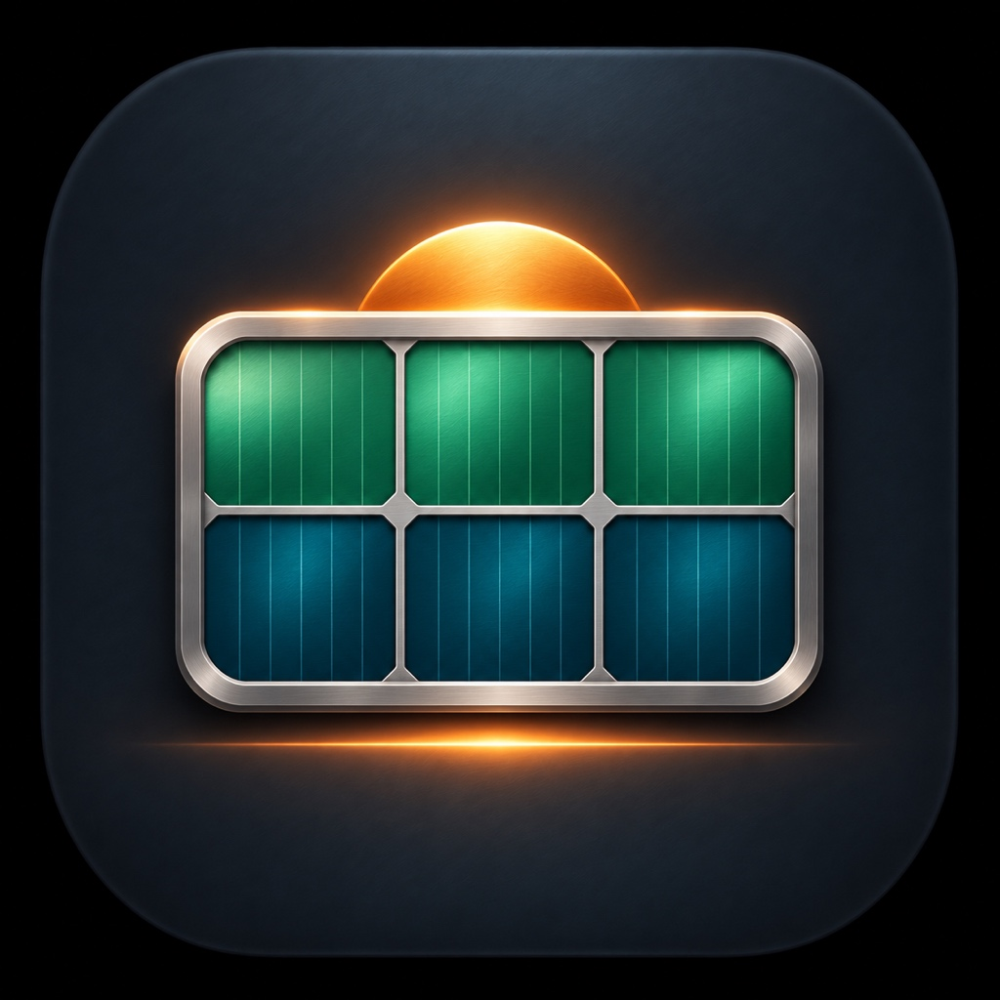
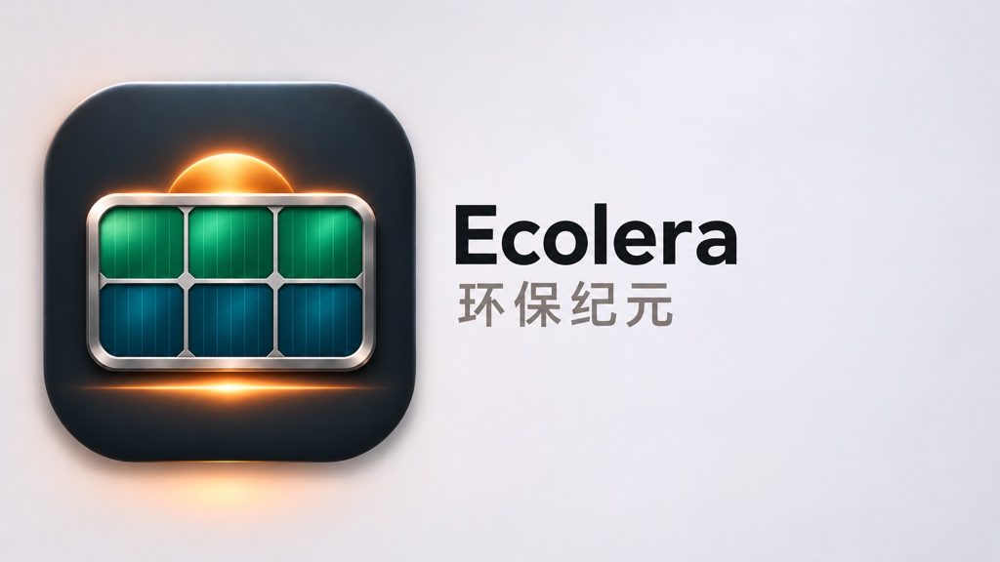

<h1> 环保纪元 (Ecolera)</h1>

面向 **机电纪元（Machinera, `mhera` v2.0.0+）** 的独立开源附属模组（Mod ID: `ecera`）。

## 核心内容

1. **高级太阳能 2（洁净室重构 & Machinera 风格全量重绘）**
   - 高级 / 混合 / 终极混合 / 量子太阳能发电机（含晴/夜/雨三态图标与放宽版 4 格充电槽）
   - 创造模式量子发电机（可调功率与 Tier 1–5 / MAX，多包输出，红石反相）
   - 分子重组仪（数据包 JSON 22 条内置配方，默认开启重制 3D 等离子体核心动画）
   - 14 种独立合成材料与 3 顶太阳能头盔（完整兼容 Machinera 纳米/量子套装减伤、量子头盔全能力与皮革染色）
2. **高级风力 / 水力动能发生器 & 经典转子磨损**
   - 耐用型（80% 动能，50% 磨损）、超频型（220% 动能，200% 磨损）、精密型（240% 动能，50% 磨损）
   - 为 Machinera 原版 5 种转子对齐经典耐久度与运行磨损公式
3. **3×3×3 巨大机器（可扩展框架）**
   - 首版提供：巨型打粉机、巨型压缩机、巨型回收机、巨型提取机、巨型洗矿机
   - 原机 + 巨构组件合成巨大机器元件，27 块 3×3×3 堆叠自动成型
   - 3×3 输入格（9 路独立并行，每格每批最多 3 份，最高 27 份并行，支持一键切换 **9 格自动平摊开关**，兼容多原料配方对齐与自动化输入）+ 3×3 输出格 + 8 个下角访问接口与可视化权限管理 + 兼容 Machinera 升级模块 + 全新科技感 GUI
4. **水煤气工业**：自带光伏+电网双供电的水煤气机（支持插入最多 2 张光伏板功率升级实现白昼 5 EU/t 自给自足）、气炉、燃气发电机
5. **天然气**：深海与冻洋海底自然生成甲烷冰矿簇，3 个甲烷冰用装罐机装入通用流体单元制成 1000 mB 天然气单元
6. **沼气**：菌种培育机（骨粉或腐肉+水→培养液，支持通用与基本培养液单元）与有机发酵机（培养液+任意食物→30×H mB 复用 Machinera `mhera:biogas` 沼气）

## 支持平台

| Minecraft | 加载器 | Java | 构建命令 |
| --- | --- | ---: | --- |
| 1.21.1 | NeoForge 21.1.265 | 21 | `./gradlew :neoforge:1.21.1:jar` |
| 26.1.2 | NeoForge 26.1.2.128 | 25 | `./gradlew :neoforge:26.1.2:jar` |
| 26.2 | NeoForge 26.2.0.95 | 25 | `./gradlew :neoforge:26.2:jar` |
| 1.19.2 | Forge 43.5.0 | 17 | `cd forge-1.19.2 && ./gradlew :forge:1.19.2:build` |

## 正式发布（v2.0.0）

前往 [GitHub Releases (`v2.0.0`)](https://github.com/Alexme9125/Ecolera/releases/tag/v2.0.0) 获取对应平台构建产物（需前置 **Machinera (`mhera`) v2.0.0+**）：

- `ecera-neoforge-1.21.1-2.0.0.jar`
- `ecera-neoforge-26.1.2-2.0.0.jar`
- `ecera-neoforge-26.2-2.0.0.jar`
- `ecera-forge-1.19.2-2.0.0.jar`

## 授权

- 代码：`LGPL-3.0-only`（见 [LICENSE](LICENSE)）
- 重绘游戏美术：`CC BY-SA 4.0`（见 [LICENSE-ASSETS](LICENSE-ASSETS)）
